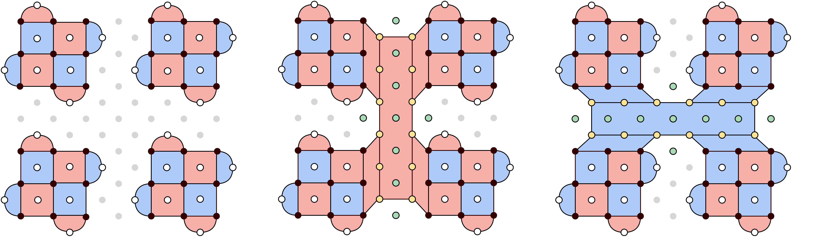
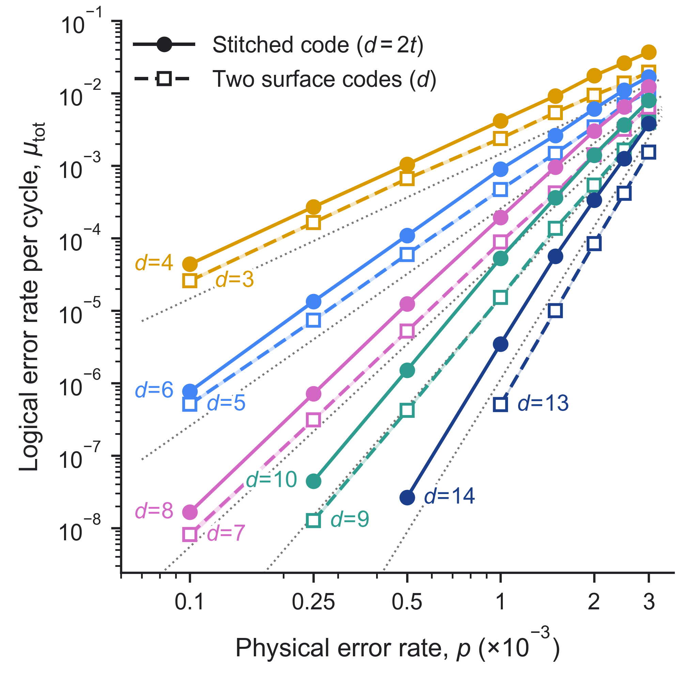
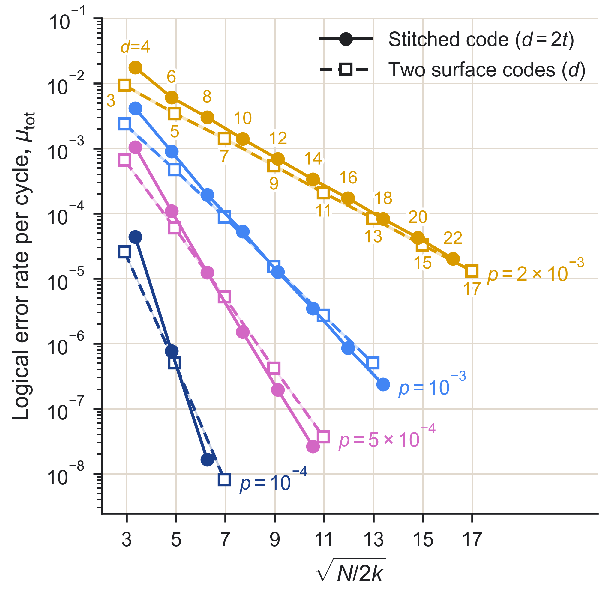
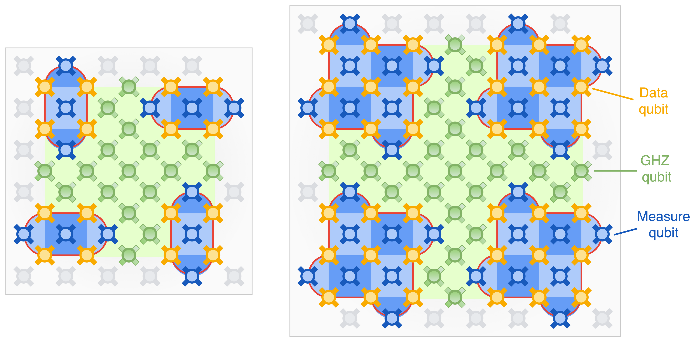
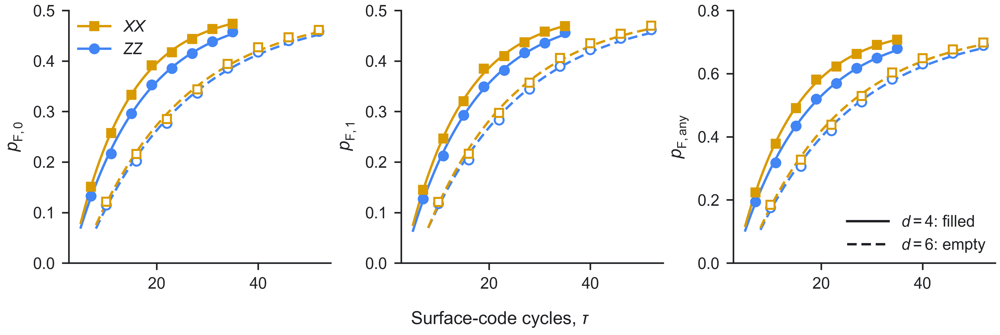

# Stitched surface codes

Circuits and data for M. A. Shalby, A. Bourassa, A. Karamlou, L. Martin, A. Morvan, N. Noll, C. Gidney, and
L. P. Pryadko, *Stitched surface codes: planar concatenation through GHZ corridors* (2026).

The stitched code concatenates four rotated surface-code patches of distance *t* with the [[4,2,2]] code. It encodes
two logical qubits at distance *d* = 2*t* in *N* = 2*d*² + 4*d* − 3 qubits on a square lattice with nearest-neighbor
couplings. The two weight-4*t* generators of the outer code are measured with verified GHZ states prepared on corridors
of ancillary qubits between the patches.



## Circuit generator

`stitched_surface_code.py` depends only on [Stim](https://github.com/quantumlib/Stim).

```python
from stitched_surface_code import build_circuit

circuit = build_circuit(t=3, rv=2, ro=1, memory="ZZ")
```

`t` ≥ 2 is the patch distance, `rv` ≥ 1 the number of GHZ verification rounds per corridor, `ro` ≥ 1 the number of
outer-code rounds (each measures both generators of the outer code), and `memory` the basis, `"ZZ"` or `"XX"`, in which
both logical qubits are prepared and measured. The circuit is noiseless and declares all detectors and both logical
observables. Its circuit distance is min(2*t*, *r*<sub>v</sub> + 3) for *r*<sub>v</sub> ≥ 2 (Eq. 8 and Table III of the
paper).

## Simulation

`memory_experiment.py` runs the simulation pipeline of the paper for one stitched code and for two independent surface
codes of distance 2*t* − 1: compilation to CZ gates with StimFlow, SI1000 noise, and decoding with PyMatching through
sinter.

```
pip install stim==1.16.0 sinter==1.16.0 pymatching==2.3.1 stimflow==1.17.dev0
python memory_experiment.py --t 3 --rv 2 --p 2e-3
```

The pinned versions are those used for the paper (Python 3.12).

The reported quantity is the logical error rate per surface-code cycle, *μ*<sub>tot</sub>, of the four-state Markov
chain of the two logical qubits (Appendix B of the paper), obtained from the failure probabilities of L0, of L1 and of
either logical qubit after *τ* cycles with an ideal initial state. For two independent surface codes with failure
probability *P*<sub>1</sub> each, *μ*<sub>tot</sub> = −ln(1 − 2*P*<sub>1</sub>)/*τ*. The stitched circuits have
*τ* = 3*r*<sub>v</sub> + 4 cycles and the surface-code circuits *τ* = 3*d*; the latter are Stim's `rotated_memory_z`
circuits without the initial reset layer, so that both codes start from a noiseless |0⟩.

## Simulation data

| File | Rows | Columns |
|---|---|---|
| `data/stitched_si1000.csv`, `data/stitched_uniform.csv` | every simulated (*t*, *r*<sub>v</sub>, *p*) under the SI1000 and the uniform depolarizing model | `t, d, r_v, p, rounds, shots, errors, errors_L0, errors_L1, selected, mu_tot_per_cycle` |
| `data/surface_si1000.csv`, `data/surface_uniform.csv` | every simulated (*d*, *p*) | `d, p, rounds, shots, errors, mu_tot_per_cycle_two_codes` |
| `data/verification_depth_t7_si1000.csv` | *t* = 7, *r*<sub>v</sub> = 2–6 (Fig. 4 of the paper) | `t, noise, mode, rv, p, rounds_R, shots, errors_joint, errors_L0, errors_L1, mu_tot_per_cycle, ci95_lo, ci95_hi, mu_01, mu_10, mu_11` |

At each (*t*, *p*), every *r*<sub>v</sub> from 1 up to one above the best value was sampled. The value used in the
figures of the paper (`selected = 1`) has the lowest *μ*<sub>tot</sub>; among values tied with it within one combined
standard error, the one with the closest L0 and L1 error counts. Rows with few errors are screening runs. For the surface
code, `shots` and `errors` refer to one copy. The uniform depolarizing model assigns the probability *p* to every gate,
idle step, measurement and reset (`stimflow.NoiseModel.uniform_depolarizing(p)`). In the verification-depth data,
`mode = corridor_only` denotes SI1000 noise restricted to the GHZ-corridor operations.




## Hardware data

The code was run on a 105-qubit Willow processor at *d* = 4 (*t* = 2, *r*<sub>v</sub> = 1) and *d* = 6 (*t* = 3,
*r*<sub>v</sub> = 2), in both memory bases, for *r*<sub>o</sub> = 1–8 outer-code rounds, with 200,000 shots per
circuit.



`experiment/logical_outcomes.csv` gives, for each of the 32 circuits and for both decoders (minimum-weight perfect
matching and correlated matching), the number of shots with no logical error, with an error on L0 only, on L1 only, and
on both. `cycles` is the number of surface-code cycles, *τ* = 1 + (*r*<sub>v</sub> + 1)(2*r*<sub>o</sub> + 1).



The complete data set, `hardware_data.zip` (1.3 GB), is attached to the [v1 release](../../releases). Circuits are
named `d<t>rv<r_v>_ro<r_o>_<basis>`. For every circuit the archive contains

| File | Content |
|---|---|
| `raw_shots/shots_*.npz` | `meas_shots` (all measurement outcomes), `sweep_bits` (random initial bits of the data qubits), `det_shots` (detection events), `obs_shots` (measured logical observables); one row per shot |
| `decoded/dem/dem_*.dem` | detector error model used for decoding, SI1000 noise at *p* = 10⁻³ |
| `decoded/predictions/{std,corr}_pred_*.npz` | `corrected_obs`: decoder prediction XOR measured observable, per shot and logical qubit, for minimum-weight perfect matching (`std`) and correlated matching (`corr`), PyMatching 2.3.1 |

A shot has a logical error on L0 (L1) when column 0 (1) of `corrected_obs` is true; `experiment/logical_outcomes.csv`
tabulates these arrays.
